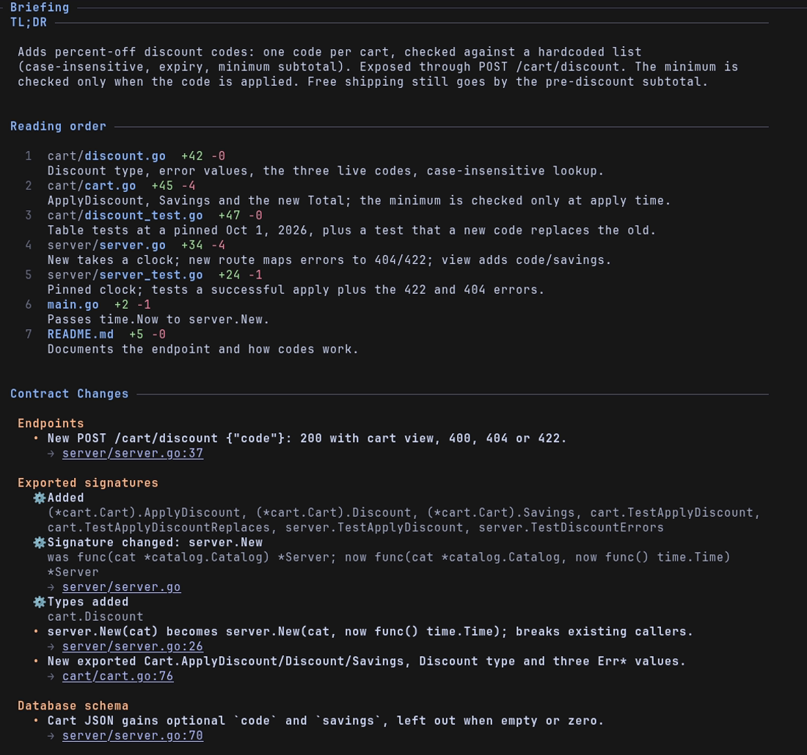
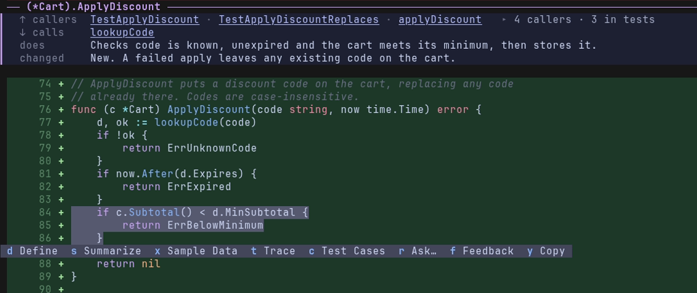
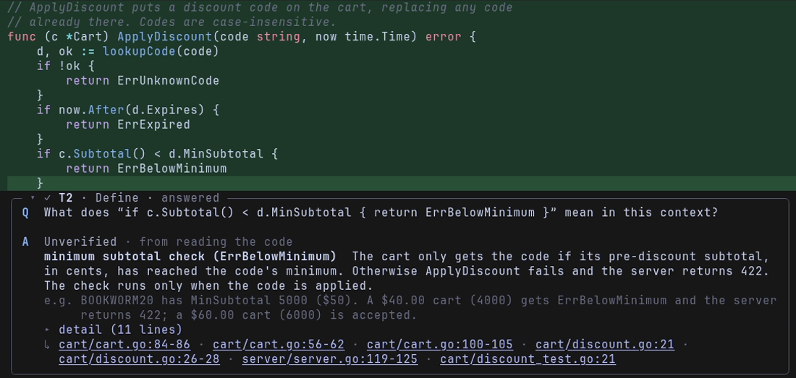
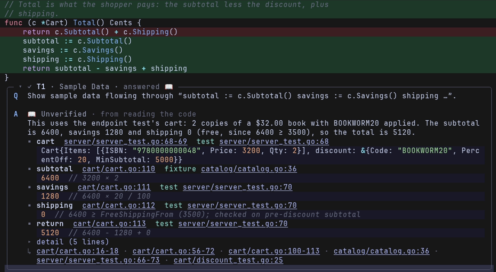
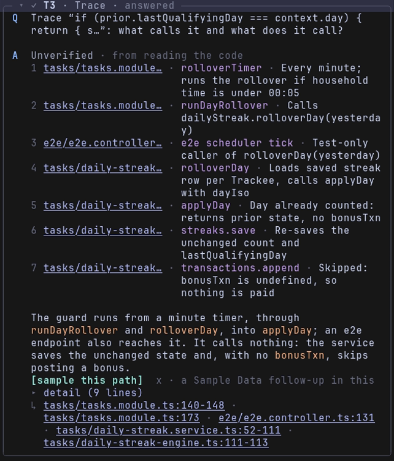
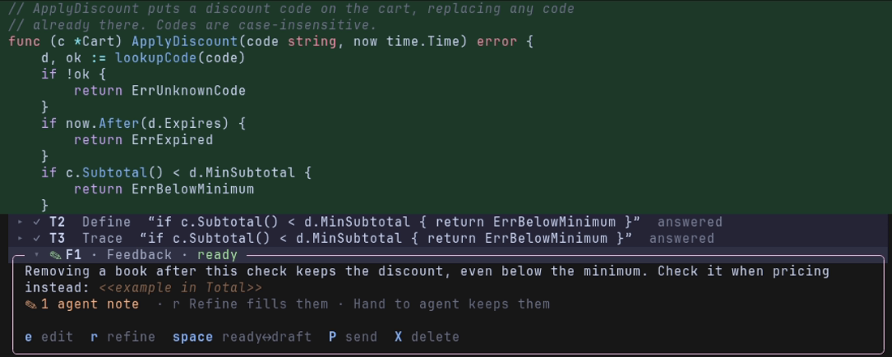
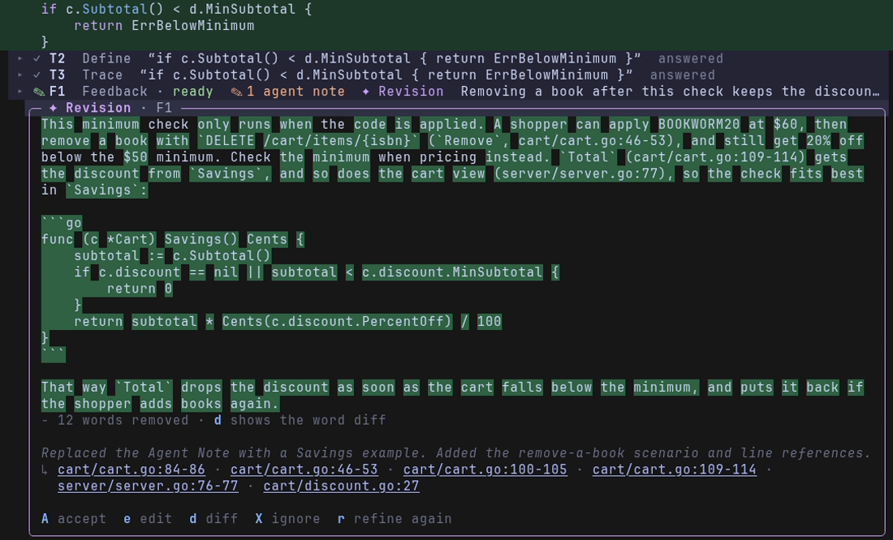
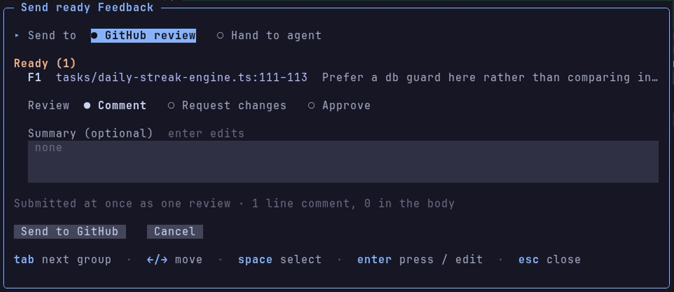
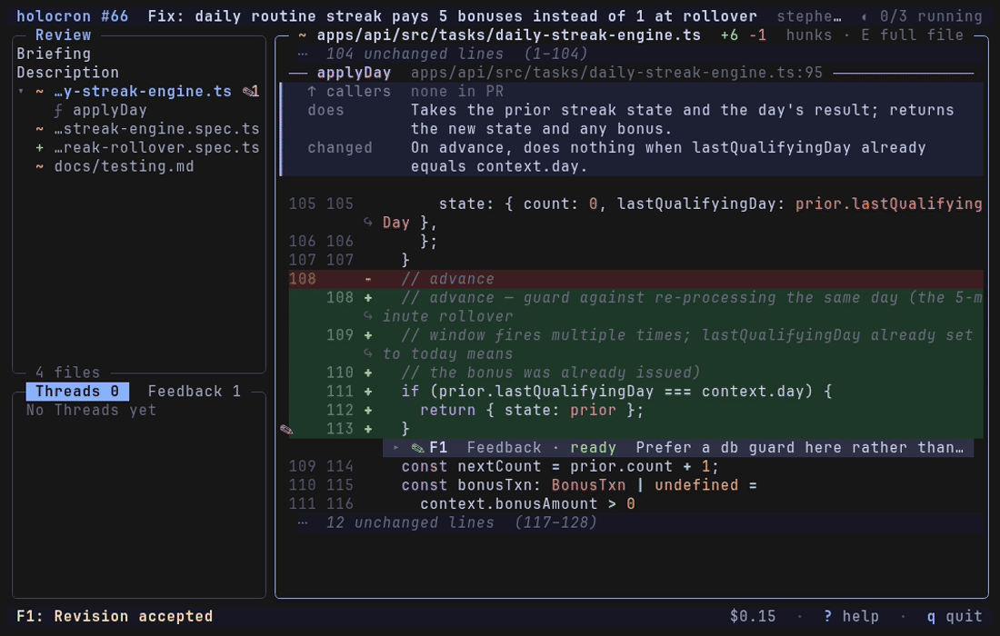

# pr-review

A private terminal workspace for reviewing a Pull Request. Ask an agent questions about the code, then sharpen your Feedback before the Author sees it.


**Jump to:** [Briefing](#read-the-briefing) · [Ask questions, get Sample Data, and trace calls](#ask-questions-get-sample-data-and-trace-calls) · [Write Feedback](#write-feedback) · [Refine it into a Revision](#refine-it-into-a-revision) · [Send it](#send-it) · [Hand Feedback to your agent](#hand-feedback-to-your-agent-to-improve-your-own-pr)

pr-review isn't an auto-review bot. The agent answers the questions you ask and tightens the Feedback you write; you decide what to say. Feedback goes out as a GitHub review, or, when the PR is yours, straight to your coding agent.

## Install

You need [git](https://git-scm.com), the [GitHub CLI](https://cli.github.com) signed in (`gh auth login`), [Claude Code](https://claude.com/claude-code) signed in, and Go 1.26+ to build it. Linux and macOS are supported.

pr-review runs in your terminal and has mouse support: drag to select code, double-click a word, click a card to open it. It works in the common terminals, including macOS Terminal and Herdr.

```sh
go install github.com/stephen-corgiat/pr-review@latest
pr-review skill install      # adds /pull-review to Claude Code, for handing Feedback to an agent
```

`go install` puts `pr-review` in `$(go env GOPATH)/bin`, usually `~/go/bin`. Make sure that's on your `PATH`.

## Review a PR

In a checkout of the repo the PR belongs to, run `pr-review` for the current branch's PR, or `pr-review 123` for PR #123. From anywhere, give it the link:

```sh
pr-review https://github.com/acme/calc/pull/123
```

Your checkout is never touched. The agent works in its own worktree, pinned to the PR's head, and can run commands there, but writes to the repo are denied. The diff is taken against the PR's base, so a stacked PR shows only its own changes. Everything is saved as you go, and reopening a PR picks up where you left off.

Press `?` at any time for every key. `q` quits.

### Read the Briefing

The Briefing opens first: a TL;DR, then a reading order that says what each changed file does. Read it top to bottom, or jump around. `}` and `{` move between files, `J` and `K` between Touched Methods, and `]` and `[` step through every change in the PR.



### Ask questions, get Sample Data, and trace calls

Select some code, by dragging, by double-clicking a word, or with `v` and `j`/`k` for whole lines. The bar under the selection lists the Questions you can ask.



| Key | Asks the agent to |
|---|---|
| `d` | **Define** the selection |
| `s` | **Summarize** it and what changed |
| `x` | show **Sample Data** flowing through it |
| `t` | **Trace** what calls it and what it calls |
| `c` | find the **Test Cases** that cover it |
| `r` | answer a Question you type |

The Answer lands as a card right under the code, so you read it where it applies. A ✅ means the agent ran something to confirm it, and a 📖 means it's from reading the code alone. The agent's running cost is in the footer.



**Sample Data** shows real values moving through the code, step by step, each linked to where it comes from:



**Trace** lists what reaches the selection and what it calls, each hop a link that jumps to the code:



### Write Feedback

Select the code and press `f`. Write the Feedback the way you'd say it, and leave a note for the agent wherever you'd rather it filled in a detail: `<<quote the exact condition with its path:line>>`.



### Refine it into a Revision

Press `r` on the card to ask the agent to **Refine** it. It fills in each note from the code and shows you a Revision. Press `e` to read it as the text you would post, and edit it if you like. `A` accepts it into your Feedback, and `space` marks the Feedback ready.



### Send it

Press `P`. **GitHub review** posts your ready Feedback to the PR as a review. **Hand to agent** is for when you're the PR's Author: GitHub won't let you review your own PR, so the Feedback goes to your coding agent instead.



## Hand Feedback to your agent, to improve your own PR

Reviewing your own PR works the same way, with one difference: **Hand to agent** sends the Feedback to your coding agent, which makes the changes.



After you send, open Claude Code in the PR's checkout, on its branch, and run `/pull-review`. It runs `pr-review export`, which prints your Feedback and the research behind it, and works through the items with you. As it goes, the agent can record what it did:

```sh
pr-review resolve F1 addressed "Renamed the flag" --commit abc1234
pr-review resolve F2 declined "Kept the retry; the API is flaky"
pr-review resolve F3 needs-you "Should this be configurable?"
```

Back in pr-review, each item shows its Outcome. A banner appears when the PR has new commits. `U` updates the session: Questions and Feedback whose code changed are marked Stale, and `Q` asks a Stale Question again. `S` shows only what changed since your last review. `D` marks handed-off Feedback done, and `O` reopens it.

## Configure

Everything is optional. Settings live in `~/.config/pr-review/settings.toml` (or `$PR_REVIEW_CONFIG_DIR/settings.toml`); unknown keys are reported, not fatal.

```toml
model = "claude-sonnet-5-5"     # default: claude-opus-5-5
effort = "medium"
sample_data = ["~/work/samples/orders.json"]

[budgets]                       # USD caps per agent call (defaults: 0.50 and 0.25)
briefing = 2.00
question = 2.00

[mcp]
allow = ["jira"]                # MCP servers the agent may use, by name

[[related_codebases]]           # other repos the agent may read
path = "~/work/billing"
alias = "BILLING"

[repos."github.com/acme/calc"]  # per-repo overrides, keyed by the remote
model = "claude-opus-5-5"
```

<details>
<summary>Shell completion</summary>

With completion loaded, `pr-review <tab>` lists the subcommands and the repo's open PRs, and `pr-review resolve <tab>` lists the Feedback waiting on you.

```sh
# bash: add to ~/.bashrc
source <(pr-review completion bash)

# zsh: once, into a directory on your $fpath
pr-review completion zsh > "${fpath[1]}/_pr-review"

# fish
pr-review completion fish > ~/.config/fish/completions/pr-review.fish
```

The PR list comes from `gh pr list` and is cached for 60 seconds. With no network, a tab press offers just the subcommands.

</details>

<details>
<summary>Where things are stored</summary>

Review Sessions live in the data directory, one per repo and PR: `~/.local/share/pr-review/` on Linux and `~/Library/Application Support/pr-review/` on macOS (or `$PR_REVIEW_DATA_DIR`). Each holds the session's event log, the agent's worktree and a scratch directory. `pr-review prune` removes the worktrees of PRs that are merged or closed.

A PR opened by link with no checkout around uses one of these, in order: the checkout its Review Session was opened from, the current directory's (when its `origin` is the PR's repo), or one another Review Session of that repo used. Otherwise pr-review clones the repo once into `clones/<owner>/<repo>` (blobless, nothing checked out) and reuses it.

</details>

## Contributing

See [`CONTRIBUTING.md`](CONTRIBUTING.md) for building, testing and the code layout, and [`GLOSSARY.md`](GLOSSARY.md) for the words this project uses.

## License

Copyright 2026 Stephen Corgiat. Licensed under the [Apache License 2.0](LICENSE). Contributors are listed in [`CONTRIBUTORS.md`](CONTRIBUTORS.md).
